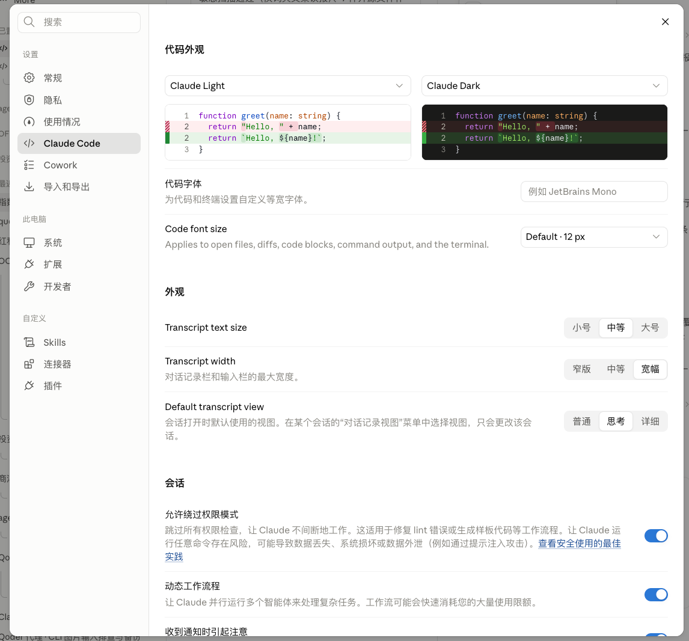
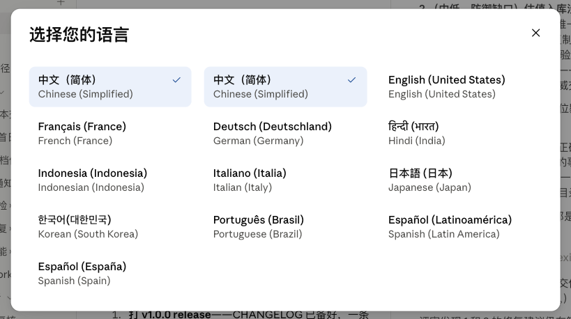

# claude-cn-patch

> 解锁 Claude Desktop（macOS）**官方预置的简体中文界面** —— 一条命令，官方 34,443 词条词典，零依赖。

Unlock the official Simplified Chinese UI hidden inside Claude Desktop for macOS. One script, Anthropic's own 34,443-entry dictionary, no Node.js or dev tools required.

## 📸 效果预览

| 设置界面 | 语言选择器 |
|---|---|
|  |  |

## ✨ 特性

- **官方词典**：使用 Anthropic 官方发布的 34,443 条界面翻译（非社区机翻）
- **零依赖**：仅用 macOS 自带工具（bash + python3 + codesign）
- **不动原 App**：所有修改只发生在 `Claude-CN` 副本上，原版毫发无损，删副本即回滚
- **防呆设计**：运行中检测、磁盘检查、打包后逐文件哈希自检（失败发生在替换前）、锚点漂移逐项提示

## 🚀 快速开始

```bash
git clone https://github.com/<you>/claude-cn-patch.git
cd claude-cn-patch
bash patch.sh
```

1. 脚本自动创建 `/Applications/Claude-CN.app` 副本并打补丁（约 2 分钟）
2. 完全退出原 Claude（菜单栏图标 → Quit Claude，⚠️ 只关窗口不算退出）
3. 打开 Claude-CN → 语言菜单选「中文（简体）」一次 → 之后每次启动都是中文

自定义路径：`bash patch.sh /目标/路径/MyClaude.app`，原 App 位置可用 `SRC_APP=/路径/Claude.app bash patch.sh` 覆盖。

## 📋 兼容性

| 项目 | 状态 |
|---|---|
| 已验证 App 版本 | 4.4212.0（2026-10-30 构建，arm64） |
| 系统 | macOS（Apple Silicon；Intel 理论可行未验证） |
| 其他版本 | 锚点按内容全局搜索，小版本差异可自动适配；差异过大时脚本会逐项提示「锚点漂移」而不会损坏 App |

## 🔧 工作原理

Anthropic 已把整套中文界面造好（词典部署在官方 CDN、多语言机制内置于 App），只是客户端的语言放行名单没有 zh-Hans。本补丁只做四件小事，全部针对副本的 `ion-dist.asar`：

1. 把 zh-Hans 追加进 App 代码里的两份语言清单（词典目录 / 选择器列表）
2. 在选择器渲染点追加中文选项
3. 装入官方词典（`catalogs/`）
4. 关闭 Electron 的 asar 完整性校验 fuse（绕开 plist 指纹 + 框架摘要两层校验），随后 ad-hoc 重签名

不替换任何界面字符串、不碰网络请求、不修改原 App。

## ❓ FAQ

| 问题 | 回答 |
|---|---|
| 打开后要求重新配置模型网关/登录？ | 副本换了签名读不了原 App 的钥匙串条目，重填一次即可 |
| Claude 官方更新后中文没了？ | 更新会覆盖补丁，重跑一次 `bash patch.sh` |
| 想回官方原版？ | 直接用回原 Claude App（从未被修改），或删除 Claude-CN |
| 提示「已损坏，无法打开」？ | 重跑一次脚本（重新签名） |
| 部分新界面还是英文？ | 词典为官方 2026-10 版，App 新版新增文案暂为英文 |
| 官方全面推送中文后？ | 本项目使命完成，删副本用回原版即可 |

## 📜 词典来源与版权

`catalogs/` 下的两份词典提取自 Anthropic 官方 CDN 下发的 Claude 界面翻译文件，版权归 Anthropic 所有，此处收录仅用于本地界面互操作。**不适用本仓库的开源许可**。如官方提出请求，将从仓库移除（届时官方中文应已全面可用）。

## 🤝 贡献

App 大版本更新导致锚点漂移时，欢迎 PR：

1. 跑 `bash patch.sh`，收集输出里「锚点漂移」的步骤名
2. 在新版 `ion-dist.asar` 里用对应功能关键词（如 `i18nReleased`、`data-i18n-catalogs`、语言选择器渲染函数）定位新锚点
3. 修改 `patch.sh` 顶部 `PAIRS` 的锚点串，提交 PR 并附上新版验证截图

## ⚖️ 免责声明

仅供个人学习研究使用。Claude 为 Anthropic Inc. 的商标，本项目与其无关联。使用本补丁产生的一切后果由使用者自行承担。

## 📝 更新日志

见 [CHANGELOG.md](CHANGELOG.md)。
